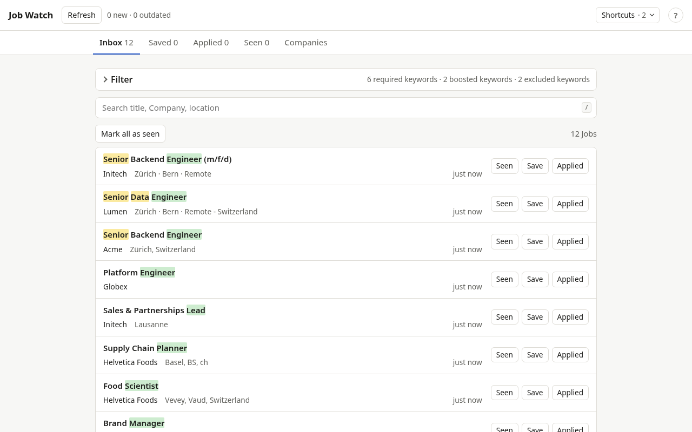
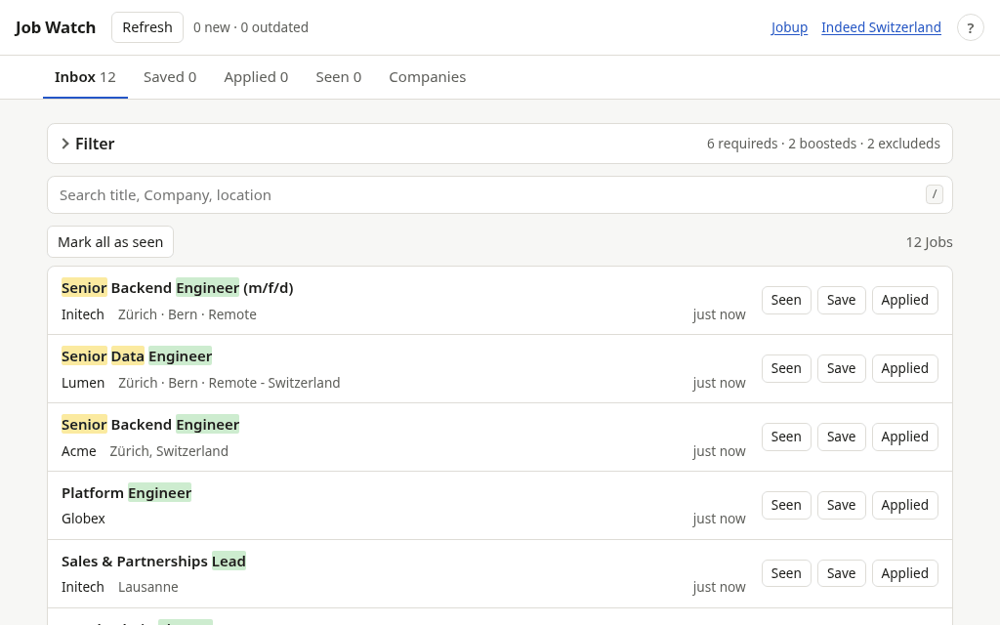

# Job Watch

An account-free job watcher: follow the Companies you care about and review their open Jobs in one Inbox, on your own machine.



## What it does

- **Follow Companies.** Paste a job board, careers page or feed link, or type a Company name; Job Watch finds the Company's Source and reads its open Jobs. Supported Sources: Greenhouse, Lever (US and EU), Ashby, SmartRecruiters, Recruitee, Workable, Personio, Oracle Cloud HCM (Oracle Recruiting Cloud careers sites), and any RSS/Atom feed.
- **Shortcuts** for careers sites whose Jobs can't be read automatically: one click opens them in a new tab.
- **One Inbox** of the Unseen Jobs that pass your **Filter**: City filters (with several spellings, e.g. Geneva / Genève / Genf), whether to include remote Jobs, and Required (green), Boosted (yellow) and Excluded (red) keywords.
- **Statuses.** Every Job is Unseen, Seen, Saved or Applied, each with its own list. A Job that disappears from its Source after a Refresh is marked Outdated.
- **Search** the list you're viewing by title, Company or location, ignoring accents and case.
- **Keyboard triage**: `j`/`k` to move, `Enter` to open, `e`/`s`/`a` to toggle Seen/Saved/Applied, `u` to undo, `/` to search, `?` for the full list.



## Why

- **No account, no hosted service.** Job Watch runs locally, bound to `127.0.0.1`. Your Companies, Filter and statuses stay in one SQLite file on your machine.
- **Official Sources only, no HTML scraping.** The server reads Jobs from public ATS job board APIs and RSS/Atom feeds and never scrapes them out of HTML pages, which would be fragile and break many sites' terms of service. A local server is still needed because most feeds can't be read from a browser (no CORS). See [ADR 0001](docs/adr/0001-local-only-app-no-html-scraping.md).

## Getting started

With Docker:

```sh
docker compose up -d
```

Then open <http://127.0.0.1:8080>. Data lives in the `job-watch-data` volume (back up by copying `job-watch.db` out of it).

Without Docker (Node >= 26, which runs the TypeScript server directly):

```sh
npm install
npm run build && npm start        # http://127.0.0.1:8080
```

For development, run the API and the Vite dev server side by side (Vite proxies `/api` to port 8080):

```sh
npm run dev:server
npm run dev:web
```

## Tests

```sh
npm test            # unit and API tests (Vitest)
npm run test:e2e    # end-to-end tests (Playwright) against the built app
npm run test:all    # typecheck + both of the above
```

Tests never touch the network: the server answers every Source read from recorded fixtures in `tests/fixtures/`. Run `npx playwright install chromium` once before the e2e tests.

The images in this README come from the same fixtures. To recapture them (needs `ffmpeg`):

```sh
node scripts/screenshots.ts
```

## Project layout

```
src/server   Node server (Hono + SQLite): Sources, refresh, Filter, the API
src/web      React front end (Vite)
src/shared   Types shared by server and front end
tests        Unit, API and e2e tests, with recorded Source fixtures
scripts      README screenshot capture
docs         ADRs and README images
```

The domain vocabulary (Company, Source, Job, Inbox, Filter…) is defined in [GLOSSARY.md](GLOSSARY.md).
